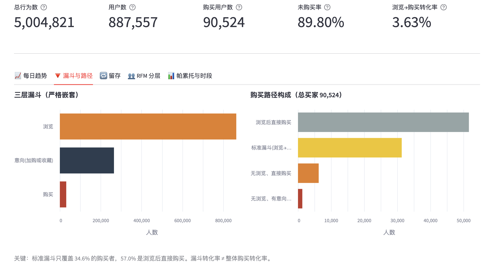

# 电商用户行为分析与经营看板

> 基于淘宝用户行为数据集（1 亿条记录，5% 抽样 500 万条）的完整分析项目：
> 数据清洗 → SQL 分析 → 可视化 → 经营看板。



## 一句话结论

**90.2% 的买家只买一次，真正的核心用户仅 4.62%。**
运营重点应从“维护核心用户”转向“提升首购用户的复购”。

## 核心发现

1. **用户价值极低，九成买家只买一次。**
   90,524 名买家中，81,662 人（90.2%）在 9 天内只购买一次；真正核心用户（R 近 · 复购 · M 高）仅 4,184 人（4.62%）。

2. **转化断在“浏览→意向”，且漏斗只覆盖三分之一的购买。**
   浏览→意向流失 59.9 万人，是绝对人数最大的断点；同时 65.4% 的购买发生在漏斗之外，主要是“浏览后直接购买”的短路径。

3. **流量峰值与转化峰值错位。**
   流量峰值在 21 点，购买转化率峰值在 10–11 点（2.95% vs 1.94%）；12-02/03 流量较工作日高 33%，但 11-25/26 同为周末却与工作日持平，不能简单归因于“周末效应”。

## 数据

| 项 | 说明 |
|---|---|
| 来源 | 阿里云天池「淘宝用户行为数据集」 |
| 规模 | 原始 100,150,807 条 → 5% 抽样 **5,007,540 条** |
| 时间 | 2017-11-25 ~ 2017-12-03（9 天） |
| 字段 | user_id / item_id / category_id / behavior / timestamp |
| 行为类型 | pv 浏览 / cart 加购 / fav 收藏 / buy 购买 |

## 分析方法

- **SQL（SQLite）**：22 道分析题、33 条 SQL，覆盖 0/A/B/C/D/E/F/G 八组
- **Python（pandas + matplotlib）**：7 张分析图
- **Streamlit**：交互式经营看板（5 个标签页）

## 交付物

| 交付物 | 文件 |
|---|---|
| 分析报告（13 页） | [report/分析报告.pdf](report/分析报告.pdf) |
| 经营看板 | [看板截图](dashboard/看板截图.png) · [app.py](dashboard/app.py) |
| SQL 脚本 | [sql/](sql/) |
| 可视化脚本 | [notebooks/](notebooks/) |
| 分析结果数据 | [dashboard/data/](dashboard/data/) |

## 目录结构

```
.
├── sql/                    # 8 个 SQL 文件，按分析组划分（0/A/B/C/D/E/F/G）
├── notebooks/              # 7 张图的 Python 脚本 + CSV 导出脚本
├── report/                 # 分析报告（Word / PDF）+ 全部图表
├── dashboard/              # Streamlit 看板 + 数据 + 截图
├── 数据导入脚本.py          # 原始 CSV → SQLite（抽样、时区转换、建索引）
├── requirements.txt
└── README.md
```

## 如何复现

1. 从天池下载 `UserBehavior.csv`，放到项目根目录
2. 运行 `python 数据导入脚本.py` 生成 `taobao.db`
3. 用任意 SQLite 客户端执行 `sql/` 下的脚本（建议先跑 `00_热身.sql`）
4. 运行 `python notebooks/01_趋势图.py` 等脚本生成图表
5. 运行 `python -m streamlit run dashboard/app.py` 启动看板

> `UserBehavior.csv`（3.5 GB）与 `taobao.db`（593 MB）体积过大，未纳入版本库。

## 口径与局限

- **5% 行级抽样**：会压低人均行为数、低估商品集中度、隐藏异常用户；关键结论已回全量数据复核。
- **9 天窗口**：“新增用户”只能定义为“数据内首次出现”，存在首日污染；7 日留存仅 2 批可算；R 维度不可用。
- **无金额、无订单号**：RFM 的 M 用总行为次数近似；F 是商品件次，不是订单数。
- **越界时间戳 0.054%**：数据库保留、分析时过滤。
- **转化率口径**：9.6% 指“9 天内浏览过的用户中购买过的比例”，与行业常见的会话级转化率不可比。

## 技术栈

SQLite · SQL · Python（pandas / matplotlib）· Streamlit
